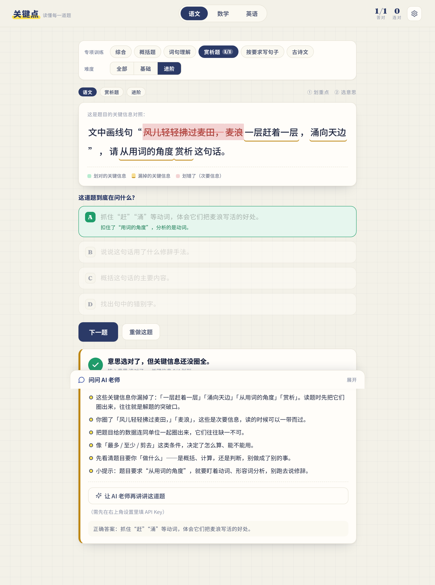

# 关键点 · 读懂每一道题


一个训练孩子**读题理解能力**的小游戏。很多孩子做错题，不是不会做，而是没读懂题目在问什么。
「关键点」把"读题"这件事拆成两步，逼孩子慢下来、动脑子：

1. **划重点** —— 点一下题干里你认为关键的字词（荧光笔效果）；
2. **选意思** —— 从 4 个选项里，选出"这道题到底在问什么"。1 个正确，3 个是精心设计的
   近似干扰项（看错范围 / 答非所问 / 只答一半 / 混淆概念）。

提交后立刻批改：告诉你漏掉了哪个关键词、选错的意思错在哪、下次读题要注意什么。
可以接入任意 OpenAI 兼容的大模型，让 AI 实时出题，并随时回答孩子的追问。

覆盖 **语文 / 数学 / 英语** 三科，面向 **小学四到六年级**。



---

## 题型与难度（专项训练）

每个学科拆成 **5 个题型**，可以只练某一个题型（专项训练），也可以「综合」练习；
每个题型都配有 **基础 / 进阶** 两个难度，可按难度筛选。选过的题型会显示该题型的正确率，
方便看出孩子哪类题最容易读错。

| 学科 | 题型 |
|---|---|
| 语文 | 概括题 · 词句理解 · 赏析题 · 按要求写句子 · 古诗文 |
| 数学 | 购物问题 · 面积与周长 · 单位换算 · 行程问题 · 多步应用题 |
| 英语 | 疑问词理解 · 句型要求 · 判断正误 · 词形填空 · 对话交际 |

内置题库共 **30 题**（15 题型 × 基础/进阶）。接了 AI 之后，每个题型都能无限出题。

---

## 直接体验（不用安装）

仓库根目录下的 **`关键点.html`** 是打包好的**单文件版本**：双击就能在浏览器里打开，
也可以拷到平板或发给别人，完全离线可玩（不接 AI 时用内置题库）。

> 想改代码/扩展功能时，用下面的开发方式；只想给孩子玩，直接发 `关键点.html` 就行。

---

## 快速开始

需要 Node ≥ 18（推荐 20+）与 pnpm（或 npm）。

```bash
cd guanjiandian
pnpm install        # 或 npm install
pnpm dev            # 打开 http://localhost:5199
```

其它命令：

```bash
pnpm build          # 类型检查 + 打包到 dist/
pnpm preview        # 本地预览打包结果
pnpm typecheck      # 只做类型检查
```

`dist/` 用的是相对路径（`base: './'`），打包后**可以直接双击 `dist/index.html` 在浏览器里打开**，
也可以拷到平板上离线玩。

---

## 接入 AI（可选，但推荐）

不接 AI 也能玩：内置了 9 道示例题（语数外各 3 道）作为兜底。

接上 AI 之后，右上角会出现「AI 出题」按钮，可以无限生成新题；底部的「问问 AI 老师」也能回答孩子的提问。

点右上角齿轮 → 填三项 → 保存：

| 字段 | 说明 | 示例 |
|---|---|---|
| 接口地址 | OpenAI 兼容的 Base URL | `https://api.deepseek.com/v1` |
| API Key | 服务商的 Key | `sk-...` |
| 模型名称 | 模型 ID | `deepseek-chat` |

面板里内置了 DeepSeek / 通义千问 / 智谱 GLM / Kimi / OpenAI 的快捷预设。

> API Key 只保存在**这台设备的浏览器 localStorage** 里，不会上传到任何别的地方。
> 换设备需要重新填。

---

## 目录结构

```
src/
  App.tsx                # 主流程与状态（含专项/难度筛选、统计）
  types.ts               # 数据模型（Question / Category / Keyword / Option / Token …）
  styles.css             # 全部样式（设计令牌 + 组件样式）
  data/
    curriculum.ts        # 题型体系（三科 × 5 题型）
    questions.ts         # 内置题库（15 题型 × 基础/进阶）+ 洗牌
  lib/
    tokenize.ts          # 把题干按关键词锚点切成可点击片段
    feedback.ts          # 批改引擎：判定对错、生成针对性建议
    ai.ts                # OpenAI 兼容客户端：出题 / 陪读问答 / 个性化点评
  components/
    Header.tsx           # 顶栏：品牌、学科切换、统计、设置
    FilterBar.tsx        # 专项训练（题型）+ 难度筛选
    StemCard.tsx         # 题干 + 荧光笔划重点
    Options.tsx          # 核心意思 4 选 1
    Feedback.tsx         # 批改结果与建议
    ChatDock.tsx         # 底部「问问 AI 老师」抽屉
    Settings.tsx         # AI 设置弹窗
```

---

## 自己出题（扩展内置题库）

在 `src/data/questions.ts` 的 `BANK` 数组里按 `Question` 结构追加即可。关键约定：

- `category` 必须是 `src/data/curriculum.ts` 里某个题型的 `id`（要新增题型就在 `CATEGORIES` 里加）；
- `difficulty` 用 `1 基础 / 2 进阶 / 3 挑战`；
- `keywords[].text` 必须与 `stem` **逐字一致**，否则不会被切出来高亮；
- `options` 恰好 4 个，且**有且仅有 1 个** `correct: true`；
- 干扰项要"像真的"：对应常见读题错误，`analysis` 里点破错在哪；
- `keywords[].role` 决定反馈里给哪类读题建议，可选值：
  `task`（做什么）/ `object`（对象、范围）/ `data`（数据、单位）/
  `condition`（限制条件）/ `target`（最终要问的）/ `trap`（易漏的陷阱词）。

> 改完题库可以跑一下数据自检：关键词是否都在题干里、每题是否恰好 1 个正确答案、
> 每个题型是否都有基础/进阶覆盖。

---

## 说明

- 设计隐喻：**作业纸 + 荧光笔**。点词 = 划荧光笔（带从左到右的书写动画），批改用红笔、正确用绿笔。
- 无障碍：按钮有 `aria-pressed`、键盘可见焦点，尊重 `prefers-reduced-motion`。
- 字体：中文走系统字体栈（PingFang / 微软雅黑 / Noto Sans SC），数字用 Fraunces；无网络时自动回退，不影响使用。
